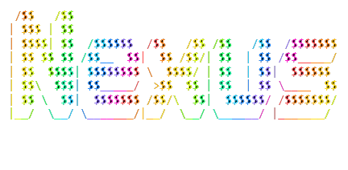

# Nexus

<p align="center">
  
</p>

A collection of personal automation scripts, utilities, and system tools for Windows.

[](#-license)
[](#️-system-requirements)
[](#-license)
[](https://python.org)
[](https://microsoft.com/powershell)
[](https://nodejs.org)

---

## 📋 Table of Contents

- [📂 Repository layout](#-repository-layout)
- [🛠️ Tools & Scripts](#️-tools--scripts)
- [📦 Installation](#-installation)
- [🚀 Usage](#-usage)
- [⚙️ System Requirements](#️-system-requirements)
- [❓ FAQ](#-faq)
- [🤝 Contributing](#-contributing)
- [📄 License](#-license)

---

## 📂 Repository layout

Every tool is a self-contained folder with its own `README.md` (purpose, usage, requirements,
caveats). Top-level folders are lowercase and hyphenated; a tool folder matches its display name.

```
Nexus/
├── powershell/                       # PowerShell / batch tooling
│   ├── adobe-firewall-blocker/
│   ├── amd-radeon-overlay-fix/       # largest tool: docs, evidence, scripts
│   ├── check-key/
│   ├── cleanup-env-paths/
│   ├── docker-remove/
│   ├── gpu-usage/
│   ├── powershell-startup-fix/
│   ├── restic-playnite-restore/
│   ├── sync-time/
│   ├── sys-info/
│   └── take-ownership/
├── python/                           # Python tooling
│   ├── achwatcher-cleanup-fix/
│   ├── cyberpunk-dlc-copy/
│   ├── excel-batch-delete/           # broken - reference only
│   ├── gdrive-image-hosting/
│   └── ping-test/
├── sync/                             # backup / sync orchestration
│   ├── backrest-trigger/
│   └── rclone-sync/
├── node/
│   └── base64-encoder/
├── assets/                           # images used by the docs
├── CONTRIBUTING.md
├── CHANGELOG.md
└── LICENSE
```

---

## 🛠️ Tools & Scripts

### 🔌 PowerShell (`/powershell/`)

| Tool | What it does |
| --- | --- |
| **[AMD Radeon Overlay Fix](powershell/amd-radeon-overlay-fix/)** | Diagnoses and auto-repairs the AMD Radeon in-game overlay (`Alt+R`) — logon hotkey-registration race, Xbox Game Bar / presence elimination, console-flash forensics, and a long-lived hidden guard. |
| **[Take Ownership](powershell/take-ownership/)** | Right-click **Take ownership** for files, folders, drives and folder backgrounds (Directory Opus *and* Explorer). Self-elevates, `takeown` + `icacls`, hands ownership to your account and grants full control to it and Administrators. |
| **[Restic / Playnite Restore](powershell/restic-playnite-restore/)** | Restores Restic snapshots onto a live Windows install: staged restore, ACL unlock (`takeown`/`icacls`), then `robocopy` with `/COPY:DT` and a second unlock pass on the destination. |
| **[Sys Info](powershell/sys-info/)** | Timestamped hardware/software snapshot (Windows, CPU, BIOS, board, memory, GPU, disks, powercfg, VBS, features, network, top processes/services) written to the Desktop. |
| **[Check Key](powershell/check-key/)** | Finds the process stealing the **Alt+Space** hotkey by killing candidates and re-testing `RegisterHotKey`. |
| **[Cleanup Env Paths](powershell/cleanup-env-paths/)** | Audits the User `PATH` for duplicates and dead entries, explains each finding, and only writes after confirmation. |
| **[GPU Usage](powershell/gpu-usage/)** | Per-process VRAM table from `\GPU Process Memory(*)\Dedicated Usage` performance counters. |
| **[Sync Time](powershell/sync-time/)** | Rebuilds the Windows Time service (`w32tm /unregister` → `/register`) and force-resyncs against public NTP peers. |
| **[Docker Remove](powershell/docker-remove/)** | Full Docker Desktop teardown: stops services, deletes install/data folders, removes the leftover service entry. Destructive. |
| **[Adobe Firewall Blocker](powershell/adobe-firewall-blocker/)** | Blocks Adobe telemetry/phone-home via Windows Firewall rules. *Not original work — see [ph33nx](https://github.com/ph33nx).* |
| **[PowerShell Startup Optimization](powershell/powershell-startup-fix/)** | Field notes + latency harness from cutting PowerShell 7 cold start from 7889 ms to 873 ms. |

### 🔧 Python (`/python/`)

| Tool | What it does |
| --- | --- |
| **[Achievement Watcher Fix](python/achwatcher-cleanup-fix/)** | Cleans emulator/DRM save and cache folders (CODEX, RUNE, Goldberg, EMPRESS, CreamAPI, …). Dry run by default. |
| **[Cyberpunk DLC Copy](python/cyberpunk-dlc-copy/)** | Extracts the `ep1` / Phantom Liberty archives from a Cyberpunk 2077 install into a `DLC Files` folder via `robocopy`. |
| **[GDrive Image Hosting](python/gdrive-image-hosting/)** | Converts Google Drive share links into direct, markdown-ready image URLs. |
| **[Ping Test](python/ping-test/)** | Threaded multi-target connectivity checker with DNS/latency diagnosis; keeps a partial report on `Ctrl+C`. |
| **[Excel Batch Delete](python/excel-batch-delete/)** | Bulk row deletion for `.xlsx`/`.xlsm`. ⚠️ **Broken — do not use**, kept for reference. |

### 📁 Sync (`/sync/`)

| Tool | What it does |
| --- | --- |
| **[RClone Sync](sync/rclone-sync/)** | Backup orchestration on top of rclone: job config, rate limiting, locking, monitoring and a launcher. |
| **[Backrest Trigger](sync/backrest-trigger/)** | Starts/stops Backrest live backups around a workload, with process detection, operation helpers and a test suite. |

### 🟢 Node (`/node/`)

| Tool | What it does |
| --- | --- |
| **[Base64 Encoder](node/base64-encoder/)** | Encodes a multi-line credential block to a URL-safe `base64url` token (placeholders only — never real secrets). |

---

## 📦 Installation

### Requirements

- **Windows 10/11**
- **Python 3.7+**
- **PowerShell 5.0+**
- **[rclone](https://rclone.org/install/)** (backup tools)
- **[restic](https://restic.net/)** (backup tools)
- **Node 18+** (encoder only)

### Instructions

1. Clone the repository:

   ```bash
   git clone https://github.com/ruZeph/Nexus.git
   cd Nexus
   ```

2. Install Python dependencies (only the tools you use):

   ```bash
   pip install openpyxl            # excel-batch-delete / any workbook tooling
   ```

3. Allow local scripts to run (once per user):

   ```powershell
   Set-ExecutionPolicy -ExecutionPolicy RemoteSigned -Scope CurrentUser
   ```

No installer, no package manager: each tool is run from its folder and documented in its own
`README.md`.

---

## 🚀 Usage

### Take ownership of a stubborn file

```powershell
powershell -ExecutionPolicy Bypass -File .\powershell\take-ownership\install-take-ownership.ps1
# then: right-click -> Take ownership   (file, folder, drive or folder background)
```

### AMD Radeon overlay guard

```powershell
# install / re-install the guard task (run elevated)
& "powershell\amd-radeon-overlay-fix\scripts\install\register-guard.ps1"

# force an immediate repair
& "powershell\amd-radeon-overlay-fix\scripts\fix-amd-overlay.ps1"

# find what is flashing console windows (event-based, catches 1 ms processes)
& "powershell\amd-radeon-overlay-fix\scripts\diagnostics\event-capture.ps1"
```

"Is the overlay alive?" and every rollback step live in
[`docs/RUNBOOK.md`](powershell/amd-radeon-overlay-fix/docs/RUNBOOK.md) section 0.

### Backups

```powershell
cd sync\rclone-sync
.\Run-RcloneJobs.ps1                      # run all enabled jobs
.\Run-RcloneJobs.ps1 -JobName "office"    # run one job
.\Run-RcloneJobs.ps1 -DryRun              # test without writing
```

### System snapshot / networking checks

```powershell
powershell -ExecutionPolicy Bypass -File .\powershell\sys-info\sys_info.ps1
python python\ping-test\net_check.py --verbose
```

---

## ⚙️ System Requirements

| Component | Requirement |
| --------- | ----------- |
| OS | Windows 10/11 |
| Python | 3.7+ |
| PowerShell | 5.0+ |
| Node | 18+ (encoder only) |
| rclone | Latest (backup scripts) |
| restic | Latest (backup scripts) |
| Disk Space | ~500 MB |
| RAM | 512 MB+ (minimal) |

Several tools need an **elevated** session: Docker Remove, Sync Time, Restic Restore (it
self-elevates), Take Ownership (self-elevates), the AMD guard installer.

---

## ❓ FAQ

**Q: Can I use these scripts on macOS/Linux?**

A: Most tools are Windows-specific (registry, firewall, `takeown`, performance counters).
PowerShell 7.x scripts may work with modifications; the Python tools are mostly portable except
where they shell out to `robocopy`.

**Q: Is it safe to run these scripts?**

A: They are used in production on the author's machine, but read the tool's `README.md` first.
Destructive tools are marked as such (Docker Remove, Achievement Watcher Fix, Adobe Blocker).
Backup tooling supports `-DryRun` — use it.

**Q: How do I update the backup job configuration?**

A: Edit `sync/rclone-sync/backup-jobs.json`.

**Q: Where does a tool keep its config or logs?**

A: Next to the tool, and anything machine-specific is git-ignored — for example
`restore_config.json` (copy it from `restore_config.example.json`) and `*.log` files.

**Q: Can I contribute improvements?**

A: Yes — see [CONTRIBUTING.md](CONTRIBUTING.md). Contributions remain under the same
Noncommercial license.

---

## 🤝 Contributing

Layout rules, naming, and the per-tool README requirement are in
**[CONTRIBUTING.md](CONTRIBUTING.md)**. Change history lives in **[CHANGELOG.md](CHANGELOG.md)**.

---

## 📄 License

This project is licensed under the **PolyForm Noncommercial License 1.0.0**.

**Summary**:

- ✅ Personal use, hobby projects, research, education
- ✅ Modify and share, with attribution
- ❌ Commercial use of any kind
- ❌ Sublicensing under different terms

See [LICENSE](LICENSE) for the binding text. Third-party scripts keep their original authorship
and licence (for example the Adobe firewall batch files, credited in their folder README).
